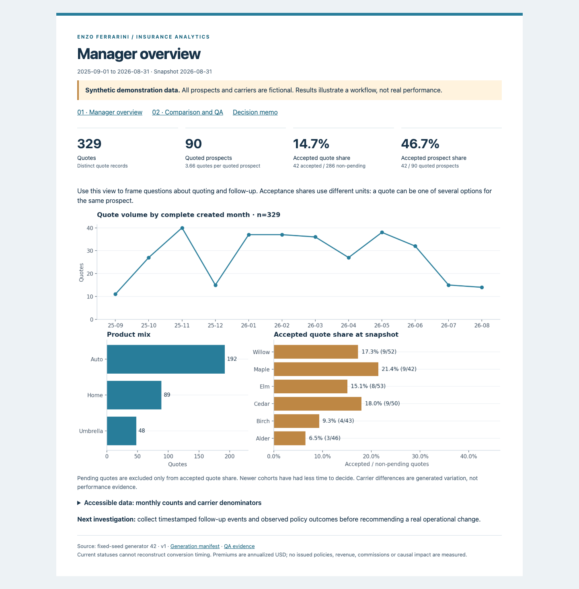
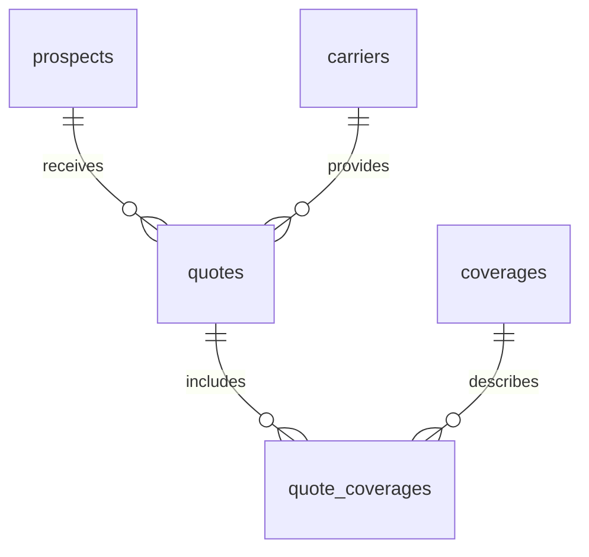

# Insurance Quote Analysis

By Enzo Ferrarini

This project started as a SQLite database for storing insurance quotes. It now includes an analysis of quoting activity, accepted quotes and premium differences across matching coverage options.

The intended reader is an independent agency manager reviewing where to investigate quoting and follow-up. SQL handles the calculations; Python generates the sample data, checks the results and builds the report.

**All records are fictional.** The sample covers September 2025–August 2026, with statuses recorded as of August 31, 2026.



[Premium comparison chart](reports/figures/comparable_ranges.png) · [Decision memo](reports/decision_memo.md) · [Data checks](reports/data_quality.md)

To view both report pages, download the repository and open `reports/index.html` in a browser.

## Results from the sample

| Measure | Result |
|---|---|
| Quotes created | 329 |
| Prospects receiving quotes | 90 of 100 |
| Quotes per quoted prospect | 3.66 |
| Accepted quote share, excluding pending quotes | 42 / 286 = **14.7%** |
| Quoted prospects with an accepted quote | 42 / 90 = **46.7%** |
| Median annual premium range across 20 matching groups | **$409.92** |

Counting quotes and counting prospects answers different questions: one person can receive several quotes and accept one. Neither acceptance measure confirms that a policy was issued.

Premium comparisons use the same prospect, product, dates and complete recorded coverage details. A lower price with a different deductible is excluded from the group. The matching groups were built into the sample to test this approach; the price ranges do not represent customer savings.

## Design choices

- Separate quote and prospect views prevent double-counting people who receive multiple options.
- Premiums are stored in annualized cents. For example, $1,497 is stored as `149700`.
- Coverage matching includes limits, deductibles and notes. Missing coverage does not count as a match.
- Monthly comparisons use complete months and include months with zero quotes.
- A fixed seed reproduces the dataset. The loader creates a new database and refuses to overwrite an existing one.



## Run locally

Tested with Python 3.13. SQLite is included with Python.

```sh
python3 -m venv .venv
source .venv/bin/activate
python -m pip install -r requirements.txt
python -m unittest discover -s tests -v
python -m src.pipeline
python -m src.analyze
```

Run these commands from the downloaded repository folder. On Windows, use `py -3.13 -m venv .venv` and activate it with `.venv\Scripts\Activate.ps1` in PowerShell.

The pipeline creates a demo database, raw data, CSV exports and check results under `data/demo/`. The analysis writes HTML pages, charts and the memo to `reports/`. The original `insurance.db` is not modified.

For another run, choose new output folders:

```sh
python -m src.pipeline --output build/demo --prospects 1000 --seed 42
python -m src.analyze --data build/demo --output build/report
```

Report outputs can be replaced; use a new folder to keep an earlier version. The overview screenshot is a browser capture and is not regenerated by these commands.

## Explore the code

| Path | Contents |
|---|---|
| `schema.sql` | Tables, constraints, indexes and original comparison view |
| `sql/` | Five analytical queries and monthly changes using LAG |
| `src/` | Data generation, loading, validation and report creation |
| `tests/` | Hand-calculated examples and regression tests |
| `docs/` | Metric definitions, data dictionary and generation assumptions |
| `reports/` | Report pages, figures, memo and supporting results |
| `examples/` | Sample inserts and update/delete examples that roll back |

## Validation and limits

The project includes 15 regression tests and 31 checks on the default dataset. SQL and pandas agree on all twelve monthly counts and five filter selections. The [eight-quote example](docs/fixture_expectations.md) shows the expected calculations by hand.

This is a snapshot of fictional quotes. It has no issued policies, response timestamps, commissions or acquisition costs, so it cannot establish conversion timing, revenue or operational impact. Newer quotes have had less time to receive a decision. Matching the recorded coverage fields also leaves out details that would matter in a real contract review.

[Metric definitions](docs/metrics.md) · [Data dictionary](docs/data_dictionary.md) · [Generation assumptions](docs/generation_assumptions.md) · [Original database design](docs/original_design.md) · [Database walkthrough](https://youtu.be/z1vavXMySBo)
